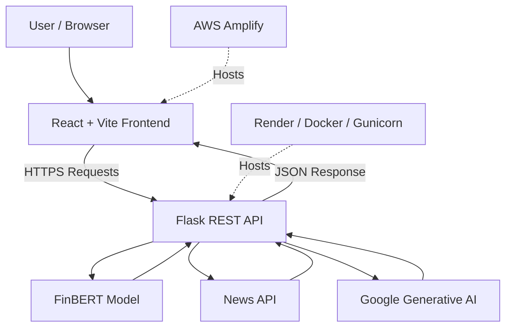

# 📈 Dristikon AI
### AI-Powered Financial News & Sentiment Analysis Platform

Dristikon AI is a full-stack, AI-powered web application designed to analyze financial news sentiment and help users explore financial information through an interactive dashboard.

The platform combines **Natural Language Processing (NLP), Machine Learning, React, and Flask** to deliver sentiment insights using **FinBERT**, a transformer-based model specialized in financial text.

The application is deployed using **AWS Amplify** for the frontend and **Render** for the backend, with Docker-based containerization.

### 🌐 Live Application

- **Live Website:** https://main.d2y4qmz5n42qco.amplifyapp.com/
- **Backend API:** https://dristikon-backend.onrender.com/
- **Health Check:** https://dristikon-backend.onrender.com/health
- **GitHub Repository:** https://github.com/Dashcloud-ML/sentiment_analysis

---

## 📌 Project Overview

Financial markets generate enormous amounts of news and information every day. Understanding the sentiment behind financial headlines can help users interpret market-related information more effectively.

Dristikon AI addresses this challenge by integrating financial news, AI-driven sentiment classification, and a chatbot into a unified platform.

The application enables users to:

- Explore financial news through an interactive interface.
- Analyze financial text using a pretrained NLP model.
- Identify positive, negative, and neutral sentiment.
- Interact with an AI-powered chatbot.
- Access the platform through a responsive web application.

**Note:** Dristikon AI is intended for informational and educational purposes, not financial or investment advice.

---

## ✨ Key Features

### 🧠 1. AI-Powered Sentiment Analysis

Dristikon AI uses **FinBERT**, a transformer-based language model trained for financial sentiment analysis.

The model classifies financial text into three categories:

- 🟢 **Positive:** Indicates favorable financial sentiment.
- 🔴 **Negative:** Indicates unfavorable financial sentiment.
- 🟡 **Neutral:** Indicates balanced or non-directional sentiment.

Example input:

```text
Apple reported record profits and strong revenue growth.
```

Expected sentiment category:

```text
Positive
```

The actual prediction and confidence score depend on the model output.

### 📰 2. Financial News Feed

The platform provides a news interface for exploring financial headlines and related information.

Features include:

- Financial news browsing.
- News content integration through external APIs.
- A dedicated news-feed interface.
- Loading indicators and responsive UI components.

### 🤖 3. AI Chatbot

Dristikon AI includes an AI-assisted chatbot interface.

The backend integrates with Google's Generative AI services to support conversational functionality.

The chatbot's availability depends on API configuration and external service availability.

### 📊 4. Interactive Dashboard

The React-based interface provides a central place for interacting with the application's financial news and AI features.

The frontend uses modern UI libraries and visualization tools to provide a responsive user experience.

### ☁️ 5. Cloud-Based Deployment

The application follows a decoupled deployment architecture:

- **AWS Amplify:** Hosts the React frontend.
- **Render:** Hosts the Flask backend.
- **Docker:** Packages the backend and its dependencies.
- **Gunicorn:** Serves the Flask application.
- **GitHub:** Maintains source code and supports automated workflows.

---

## 🛠️ Technology Stack

| Category | Technologies |
|----------|-------------|
| Frontend | React.js, JavaScript, Vite |
| Styling | Tailwind CSS |
| UI Libraries | Framer Motion, Lucide React |
| Data Visualization | Chart.js, react-chartjs-2 |
| API Communication | Axios |
| Backend | Python, Flask, Flask-CORS |
| Machine Learning | FinBERT, PyTorch |
| NLP Framework | Hugging Face Transformers |
| External APIs | News API, Google Generative AI |
| Web Server | Gunicorn |
| Containerization | Docker |
| Frontend Hosting | AWS Amplify |
| Backend Hosting | Render |
| Version Control | Git, GitHub |
| Automation | GitHub Actions |

---

## 🏗️ System Architecture

Dristikon AI follows a frontend-backend architecture in which the user interface, API services, and machine learning inference are separated.



### How the Application Works

**Step 1 — User Interaction**

The user opens the React application hosted on AWS Amplify and interacts with the dashboard, news feed, sentiment analysis, or chatbot interface.

**Step 2 — API Communication**

The frontend communicates with the Flask backend using HTTP requests.

**Step 3 — Backend Processing**

The Flask application handles incoming requests and routes them to the relevant service.

**Step 4 — AI Model Inference**

For sentiment analysis, financial text is processed using FinBERT.

**Step 5 — Response Generation**

The backend returns the result to the frontend, where it is displayed to the user.

---

## 📁 Project Structure

```text
sentiment_analysis/
│
├── backend_old/
│   ├── Dockerfile
│   ├── requirements.txt
│   ├── run.py
│   └── ...                 # Flask routes and backend modules
│
├── frontend2/
│   ├── public/
│   ├── src/
│   │   ├── assets/
│   │   ├── components/
│   │   └── ...
│   ├── package.json
│   └── ...
│
├── .gitignore
└── README.md
```

### Directory Explanation

**`frontend2/`**

Contains the React application, including reusable components, frontend assets, and user-interface functionality.

**`backend_old/`**

Contains the Flask backend, sentiment analysis integration, API endpoints, and Docker configuration.

---

## 🚀 Getting Started

Follow these instructions to run Dristikon AI locally.

### Prerequisites

Install the following:

- Git
- Node.js and npm
- Python
- pip

Some application features also require external API credentials.

### 1. Clone the Repository

```bash
git clone https://github.com/Dashcloud-ML/sentiment_analysis.git
cd sentiment_analysis
```

### 2. Configure the Backend

Navigate to the backend directory:

```bash
cd backend_old
```

Create a virtual environment:

```bash
python -m venv .venv
```

Activate it.

**Windows PowerShell:**

```powershell
.\.venv\Scripts\Activate.ps1
```

**Linux / macOS:**

```bash
source .venv/bin/activate
```

Install Python dependencies:

```bash
pip install -r requirements.txt
```

### 3. Configure Environment Variables

Configure the credentials required by the backend integrations.

Example:

```env
NEWSAPI_KEY=your_news_api_key
GEMINI_API_KEY=your_gemini_api_key
```

Use the environment variable names expected by your backend code.

Never commit real API keys or `.env` files to GitHub.

### 4. Start the Backend

```bash
python run.py
```

The backend will start using the configuration defined in the Flask application.

The deployed Docker configuration uses port `7860`.

### 5. Configure the Frontend

Open another terminal and navigate to:

```bash
cd frontend2
```

Install frontend dependencies:

```bash
npm install
```

Ensure the frontend's API base URL points to the backend instance you want to use.

### 6. Start the Frontend

```bash
npm run dev
```

Open the URL displayed by Vite, typically:

```text
http://localhost:5173
```

The application should now be accessible locally.

---

## 🔌 REST API Endpoints

The Flask backend provides API endpoints for application functionality.

### 1. Health Check

**Endpoint:**

```http
GET /health
```

**Production URL:**

```text
https://dristikon-backend.onrender.com/health
```

Used to verify whether the backend application is running.

### 2. Sentiment Analysis

**Endpoint:**

```http
POST /sentiment/analyze
```

**Request Body:**

```json
{
  "text": "Apple reported strong revenue growth."
}
```

**Example cURL Request:**

```bash
curl -X POST \
  https://dristikon-backend.onrender.com/sentiment/analyze \
  -H "Content-Type: application/json" \
  -d '{"text":"Apple reported strong revenue growth."}'
```

The endpoint processes the supplied text using the backend sentiment analysis service.

The exact JSON response structure is defined by the Flask implementation.

---

## ☁️ Deployment Architecture

Dristikon AI uses separate hosting services for its frontend and backend.

### Frontend — AWS Amplify

The frontend is developed using React and Vite.

**Deployment configuration:**

```text
Framework: React + Vite
Hosting: AWS Amplify
Build Command: npm run build
Output Directory: dist
Frontend Directory: frontend2
```

Live application:

https://main.d2y4qmz5n42qco.amplifyapp.com/

### Backend — Render

The Flask backend is deployed as a Docker-based web service on Render.

**Deployment configuration:**

```text
Backend: Flask
Runtime: Docker
Web Server: Gunicorn
Container Port: 7860
Hosting: Render
```

Backend URL:

https://dristikon-backend.onrender.com/

### Docker Containerization

Docker packages the backend application with its Python dependencies, providing a consistent runtime environment.

The container runs the Flask application using Gunicorn.

### Deployment Considerations

Free-tier hosting may introduce:

- Cold-start delays after inactivity.
- Limited memory and CPU resources.
- Longer machine learning model initialization times.
- Temporary request delays.

These limitations should be considered when evaluating production performance.

---

## 🔐 Security Considerations

The application follows several important security principles:

- API credentials should be stored in environment variables.
- Sensitive credentials must never be committed to GitHub.
- HTTPS should be used for communication between deployed services.
- CORS should be restricted to trusted frontend origins.
- Backend error messages should avoid exposing sensitive information.
- Compromised or exposed API keys should be rotated.

---

## 📈 Future Enhancements

Potential improvements include:

- Real-time market data integration.
- Historical sentiment trend analysis.
- More advanced financial data visualizations.
- Improved FinBERT inference performance.
- Automated testing and API monitoring.
- Improved caching and model initialization.
- Enhanced chatbot capabilities.
- Additional financial news filtering options.
- Expanded CI/CD automation.
- Better error handling and accessibility.

---

## 🎯 Learning Outcomes

Building Dristikon AI provides practical experience with:

- Developing full-stack applications using React and Flask.
- Integrating transformer-based NLP models into REST APIs.
- Working with financial sentiment classification.
- Containerizing Python applications using Docker.
- Deploying frontend and backend services independently.
- Managing cloud-hosted application configurations.
- Integrating third-party APIs.
- Debugging cross-origin requests and production asset paths.
- Working with GitHub-based development and deployment workflows.

---

## ⚠️ Disclaimer

Dristikon AI is an educational and informational project.

Sentiment analysis results are generated by a machine learning model and may not always accurately reflect market conditions.

The application does not provide financial advice, investment recommendations, or guarantees regarding market performance.

---

## 🔗 Project Links

- **Live Application:** https://main.d2y4qmz5n42qco.amplifyapp.com/
- **Backend Health Check:** https://dristikon-backend.onrender.com/health
- **Source Code:** https://github.com/Dashcloud-ML/sentiment_analysis

---

### ⭐ Support the Project

If you find Dristikon AI interesting, consider starring the repository on GitHub.

**Built with React, Flask, FinBERT, Docker, AWS Amplify, and Render.**
